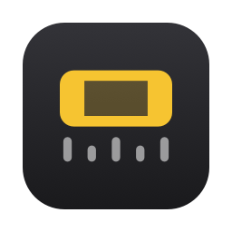
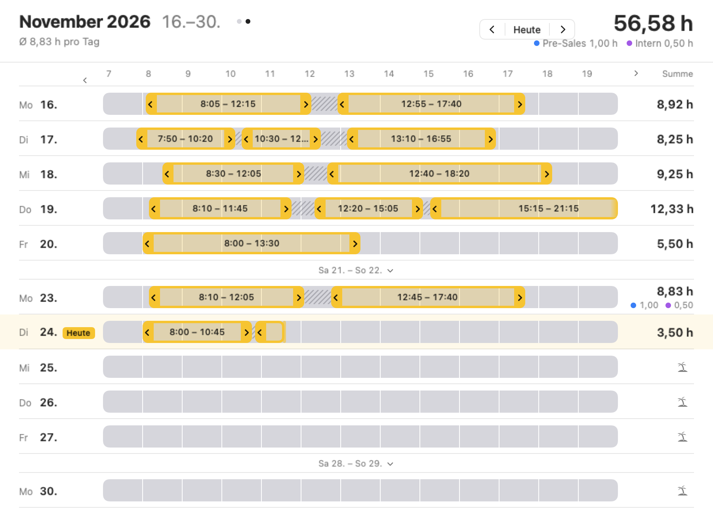

<p align="center">
  
</p>

<h1 align="center">Pensum</h1>

<p align="center">
  Arbeitszeit erfassen, ohne daran zu denken.<br>
  Eine Mac-App für die Menüleiste: startet morgens, merkt Pausen, rechnet in Dezimalstunden.
</p>

<p align="center">
  <a href="#was-pensum-macht">Funktionen</a> ·
  <a href="#installieren">Installieren</a> ·
  <a href="#deine-daten">Daten</a> ·
  <a href="#entwickeln">Entwickeln</a>
</p>

<p align="center">
  
  
  
  
</p>

<p align="center">
  <picture>
    <source media="(prefers-color-scheme: dark)" srcset="docs/readme/overview-dark.png">
    
  </picture>
</p>

Pensum sitzt als kleines Symbol in der Menüleiste. Beim ersten Aufklappen des Tages fragt es einmal, ob die Arbeitszeit starten soll. Danach erkennt es Pausen von selbst: wenn du den Bildschirm sperrst, den Mac zuklappst oder eine Weile nichts tippst. Am Monatsende stehen alle Tage als Zeitleisten untereinander, und du korrigierst sie mit der Maus statt in Formularen.

## Was Pensum macht

- **Einmal fragen, dann still sein.** Morgens erscheint ein kleines Fenster mit *Start*, *Später* und *Heute frei*. Liegt das Aufklappen schon eine Weile zurück, kannst du auch ab diesem Zeitpunkt starten. An freien Tagen und im Urlaub fragt Pensum nicht.
- **Pausen von selbst.** Sperren, Zuklappen, Ruhezustand und Leerlauf (Standard: 15 Minuten ohne Eingabe) werden zu Pausen. Kommst du nach dem Zuklappen am Abend nicht zurück, endet der Tag dort.
- **Der Status auf einen Blick.** Der Punkt am Symbol ist grün, wenn die Zeit läuft, orange in einer Pause und rot, wenn nichts läuft.

  <picture>
    <source media="(prefers-color-scheme: dark)" srcset="docs/readme/menubar-dark.png">
    
  </picture>

- **Bearbeiten wie Videoschnitt.** Jeder Arbeitsblock hat Griffe an beiden Enden. Ziehen verschiebt Beginn und Ende, ein Klick auf eine Pause entfernt sie, ein Doppelklick fügt eine Pause oder einen neuen Block ein. Zieht man einen Block ganz zusammen, wird er gelöscht. Alles lässt sich mit ⌘Z zurücknehmen.
- **Halbe Monate.** Die Übersicht zeigt den 1. bis 15. und den 16. bis Monatsende, mit Summe und Tagesdurchschnitt. Wochenenden sind eingeklappt, Urlaubstage tragen eine Palme.
- **Dezimal und zu deinen Gunsten.** Zeiten erscheinen als `8,25 h`. Der Beginn wird auf 5 Minuten abgerundet, das Ende aufgerundet.
- **Nebenprojekte.** Pro Tag lässt sich ein Teil der Zeit in Viertelstunden auf Projekte verteilen, etwa Pre-Sales oder interne Arbeit.
- **CSV-Export.** Auf Wunsch exportiert Pensum den halben Monat als CSV mit Semikolon, die Excel und die meisten Zeiterfassungen direkt öffnen.

## Installieren

Pensum gibt es noch nicht als fertigen Download. Du baust es mit Xcode 26 selbst:

```bash
git clone <repo-url> pensum
```

```bash
cd pensum && xcodebuild -project Pensum.xcodeproj -scheme Pensum -configuration Release -derivedDataPath build build
```

```bash
cp -R build/Build/Products/Release/Pensum.app /Applications/
```

Danach Pensum aus dem Programme-Ordner öffnen. In den Einstellungen kannst du *Bei der Anmeldung starten* einschalten.

## Deine Daten

- **Nur auf deinem Mac.** Pensum braucht kein Konto und baut keine Netzwerkverbindung auf.
- **Ein Ort.** Alle Zeiten liegen in `~/Library/Application Support/Pensum/Pensum.store`. Zum Sichern genügt dieser Ordner.
- **Kein Zugriff auf Bedienungshilfen.** Den Leerlauf liest Pensum über die Zeit seit der letzten Eingabe. Was du tippst, sieht es nicht.

## Entwickeln

| Ordner | Inhalt |
| --- | --- |
| `Pensum/` | Die App: Menüleiste, Check-in, Übersicht, Einstellungen |
| `PensumCore/` | Swift-Paket mit der Rechenlogik: Tagessummen, Rundung, Pausenregeln, Bearbeiten, Export |
| `scripts/make-icon.swift` | Zeichnet das App-Symbol in allen Größen |
| `mockups/` | HTML-Entwürfe aus der Designphase |

Die Logik in `PensumCore` ist frei von UI und hat eigene Tests:

```bash
cd PensumCore && swift test
```

Debug-Builds kennen ein paar Startargumente zum Ausprobieren:

| Argument | Wirkung |
| --- | --- |
| `-demoStore YES` | Eigene Datei `Demo.store` mit Beispieldaten, deine echten Zeiten bleiben unberührt |
| `-openOverview YES` | Öffnet die Übersicht direkt beim Start |
| `-alwaysShowCheckIn YES` | Zeigt das Morgenfenster bei jedem Start |
| `-snapshotOverview <Pfad>` | Speichert die Übersicht als PNG, mit `-snapshotDark YES` im dunklen Erscheinungsbild |
